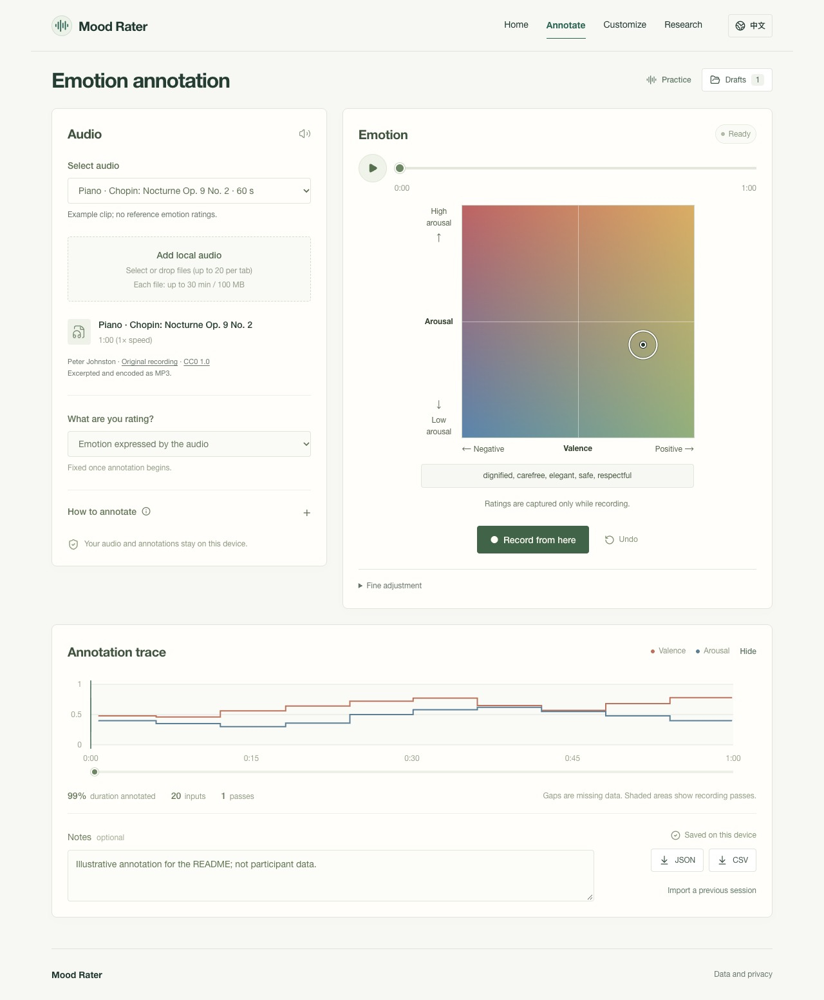

# Mood Rater

**Trace how emotion changes through sound.**

A bilingual tool for annotating music and speech on a valence–arousal map. Listen, record your ratings over time, and export them for analysis. No account or database setup is needed for the default app.

[Try the demo](https://rater.zaoan.today/annotate) | [Initial version](https://rater.zaoan.today/legacy/) | [简体中文](README.zh-CN.md) | [Documentation](docs/README.md) | [Contributing](CONTRIBUTING.md)

[](https://rater.zaoan.today/annotate)

*A local demonstration session. Ratings shown are illustrative, not participant data.*

## What you can do

- **Annotate over time.** Rate the emotion expressed by the audio or your own feelings while listening. Both axes use a 0–1 scale, with 97 emotion words as spatial guides.
- **Review and revise.** Pause, seek, re-record a section, or undo the latest recording pass. Each audio clip has its own session.
- **Keep work in your browser.** Local audio stays on your device. Drafts are saved in IndexedDB; export a backup before clearing browser storage.
- **Take the data with you.** JSON preserves raw inputs and edit history. CSV provides a 10 Hz time series, with unannotated intervals left missing.

The interface supports English and Simplified Chinese, pointer input, touch, arrow keys and sliders. Four 60-second recordings are included: piano, strings, an English address and a Mandarin interview. [Audio credits and licenses →](public/audio/README.md)

## Get started

### In your browser

1. [Open the workspace](https://rater.zaoan.today/annotate) and choose an example or add your own audio.
2. Choose what to rate, press **Start recording**, and click on the emotion map as the audio plays.
3. Stop to review, revise if needed, then export **JSON** or **CSV**.

Local files can be up to 30 minutes and 100 MiB each. Audio files are not stored with drafts; re-select the original file to resume after a refresh. [User guide →](docs/USER-GUIDE.md)

### On your computer

Requires **Node.js 22.13+** and npm.

```sh
git clone https://github.com/souflex56/mood-rater-demo.git
cd mood-rater-demo
npm ci
npm run dev
```

Open the URL printed in your terminal, normally **http://127.0.0.1:5173**. The default app works without an environment file, login or cloud resources.

Deploy on your choice of **Node.js or Docker host**; the public website is a demonstration. See the [self-hosting guide](docs/DEPLOYMENT.md).

Built with [React](https://react.dev/), [TypeScript](https://www.typescriptlang.org/) and [Vinext](https://github.com/cloudflare/vinext). A separate [Cloudflare adapter](deploy/cloudflare/README.md) supports optional research collection.

## Make it yours

Change the configuration files to use your own recordings and interface settings:

| Configure | File |
| --- | --- |
| Audio clips and bilingual titles | [`config/audio-library.json`](config/audio-library.json) |
| Emotion words and their coordinates | [`config/emotion-tags.json`](config/emotion-tags.json) |
| Map colors, axis labels and guide radius | [`config/va-interface.json`](config/va-interface.json) |

[Customization guide →](docs/CUSTOMIZATION.md)

## Documentation

| I want to… | Start here |
| --- | --- |
| Annotate, save and export | [User guide](docs/USER-GUIDE.md) |
| Understand timestamps, missing values and editing | [Annotation protocol](docs/PROTOCOL.md) |
| Configure or deploy my own instance | [Customization](docs/CUSTOMIZATION.md), [deployment](docs/DEPLOYMENT.md) |
| Enable participant submissions | [Optional research backend](deploy/cloudflare/README.md), [API](docs/API.md) |
| Find code, checks or historical records | [Project map](docs/README.md), [contributing](CONTRIBUTING.md) |

Research collection is **disabled by default**. Enabling it requires a separate deployment with storage and owner configuration.

## Research and citation

Inspired by [Simin Yang’s research on emotion perception in music](https://ieeexplore.ieee.org/document/9468946):

Simin Yang, Courtney N. Reed, Elaine Chew and Mathieu Barthet. [*Examining Emotion Perception Agreement in Live Music Performance.*](https://ieeexplore.ieee.org/document/9468946) IEEE Transactions on Affective Computing, 14(2), 1442–1460, 2023 (early access 2021). [DOI](https://doi.org/10.1109/TAFFC.2021.3093787) | [BibTeX](public/citation.bib)

General audio, interval editing and 10 Hz exports extend the original work. The tool collects human ratings; its tests do not establish psychometric validity or reproduce the paper’s findings. See the [protocol](docs/PROTOCOL.md#7-relationship-to-the-paper--与论文的关系).

## Contribute and reuse

Bug reports, documentation, translations and focused improvements are welcome. [Read the contribution guide](CONTRIBUTING.md) or [open an issue](https://github.com/souflex56/mood-rater-demo/issues/new/choose).

Project code is licensed under [MIT](LICENSE). Bundled recordings and third-party code retain their own licenses; see [third-party notices](THIRD_PARTY_NOTICES.md) before redistributing them.
