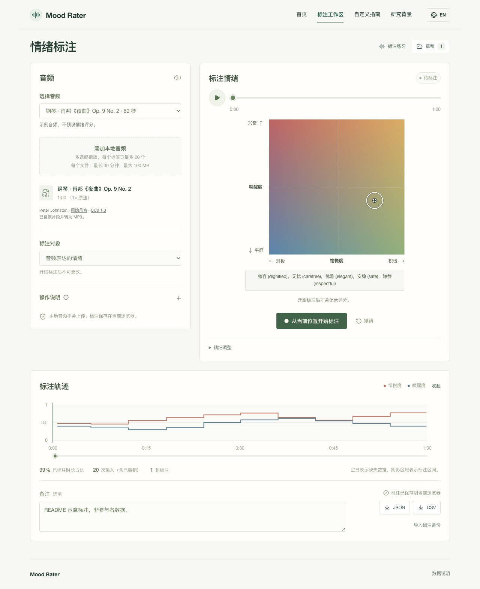

# Mood Rater

**记录音频中的情绪变化。**

在聆听音乐或人声时，通过愉悦度–唤醒度坐标记录情绪随时间的变化，并导出数据用于分析。支持中英双语，默认使用无需账号或数据库配置。

[在线体验](https://rater.zaoan.today/annotate) | [English](README.md) | [文档导航](docs/README.md) | [参与贡献](CONTRIBUTING.md#中文)

[](https://rater.zaoan.today/annotate)

## 可以做什么

- **随时间标注。** 记录音频表达的情绪，或聆听时自身的感受。两个坐标轴均采用 0–1 范围，97 个情绪词帮助定位。
- **回听与修改。** 暂停、定位、重新标注局部区间，或撤销最近一轮标注。不同音频分别保存。
- **在浏览器中保存。** 本地音频不会上传，草稿保存在 IndexedDB。清除浏览器数据前，请先导出备份。
- **导出分析数据。** JSON 保留原始输入与修改历史；CSV 提供 10 Hz 时间序列，未标注区间保持为空缺。

支持鼠标、触屏、方向键和滑块。内置钢琴、弦乐、英文演讲和中文访谈四个 60 秒片段，附[音频来源与授权](public/audio/README.md)。

## 开始使用

### 在线体验

1. 打开[标注工作区](https://rater.zaoan.today/annotate)，选择示例或添加本地音频。
2. 确定标注对象，点击「开始标注」，边听边在情绪坐标图中点击。
3. 停止后回顾或修改，完成后导出 **JSON** 或 **CSV**。

每个本地音频最长 30 分钟、最大 100 MiB。草稿不包含音频文件；刷新后，重新选择原文件即可继续。[使用指南 →](docs/USER-GUIDE.zh-CN.md)

### 本地运行

需要 **Node.js 22.13+** 和 npm。

```sh
git clone https://github.com/souflex56/mood-rater-demo.git
cd mood-rater-demo
npm ci
npm run dev
```

打开终端输出的网址，通常为 **http://127.0.0.1:5173**。默认应用不需要环境变量文件、登录或云端资源。

可在自选的 **Node.js 或 Docker 环境**部署；公开网站仅供演示。详见[自托管指南](docs/DEPLOYMENT.zh-CN.md)。

技术栈为 [React](https://react.dev/)、[TypeScript](https://www.typescriptlang.org/) 和 [Vinext](https://github.com/cloudflare/vinext)。需要集中采集研究数据时，可选择独立的 [Cloudflare 后台适配](deploy/cloudflare/README.md)。

## 用于自己的项目

通过配置文件替换音频、调整参考词和界面：

| 配置内容 | 文件 |
| --- | --- |
| 音频列表与中英文名称 | [`config/audio-library.json`](config/audio-library.json) |
| 情绪词及其坐标 | [`config/emotion-tags.json`](config/emotion-tags.json) |
| 配色、坐标轴标签与参考词筛选范围 | [`config/va-interface.json`](config/va-interface.json) |

[自定义指南 →](docs/CUSTOMIZATION.md)

## 文档导航

| 我想…… | 阅读 |
| --- | --- |
| 了解标注、保存和导出 | [使用指南](docs/USER-GUIDE.zh-CN.md) |
| 理解时间戳、空缺与区间覆盖 | [标注协议](docs/PROTOCOL.md) |
| 定制或部署自己的版本 | [自定义指南](docs/CUSTOMIZATION.md)、[部署指南](docs/DEPLOYMENT.zh-CN.md) |
| 开启研究参与者提交 | [可选研究后台](deploy/cloudflare/README.md)、[API](docs/API.md) |
| 查找代码、检查命令与历史记录 | [项目导航](docs/README.md)、[贡献指南](CONTRIBUTING.md#中文) |

研究采集**默认关闭**，启用时需单独配置部署、存储和后台所有者。

## 研究背景与引用

工具设计参考了 [Simin Yang 关于音乐情绪感知的研究](https://ieeexplore.ieee.org/document/9468946)：

Simin Yang, Courtney N. Reed, Elaine Chew, Mathieu Barthet. [*Examining Emotion Perception Agreement in Live Music Performance.*](https://ieeexplore.ieee.org/document/9468946) IEEE Transactions on Affective Computing, 14(2), 1442–1460, 2023（2021 年提前在线发表）。[DOI](https://doi.org/10.1109/TAFFC.2021.3093787) | [BibTeX](public/citation.bib)

通用音频、区间编辑和 10 Hz 导出属于工程扩展。本工具采集人的主观评分；软件测试不代表心理测量效度得到验证，也不代表复现了论文结论。详见[标注协议](docs/PROTOCOL.md#7-relationship-to-the-paper--与论文的关系)。

## 参与贡献与使用许可

欢迎反馈问题、完善文档和翻译，或提交范围明确的改进。请先阅读[贡献指南](CONTRIBUTING.md#中文)，也可以[新建 Issue](https://github.com/souflex56/mood-rater-demo/issues/new/choose)。

本项目代码采用 [MIT 许可证](LICENSE)。内置音频与第三方代码保留各自的许可；再分发前请查看[第三方许可说明](THIRD_PARTY_NOTICES.md)。

*[初始版本](https://rater.zaoan.today/legacy/)*
